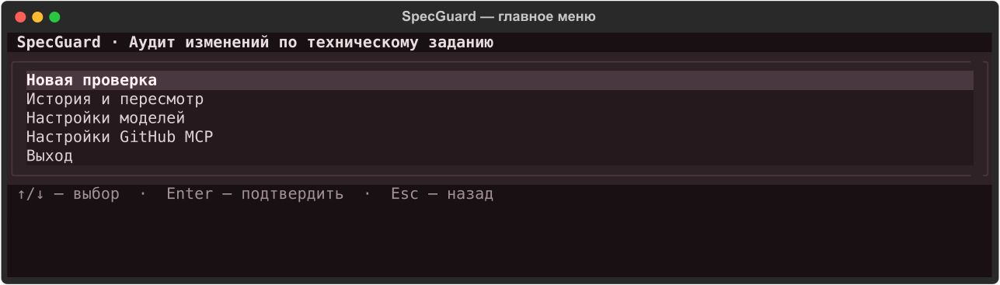
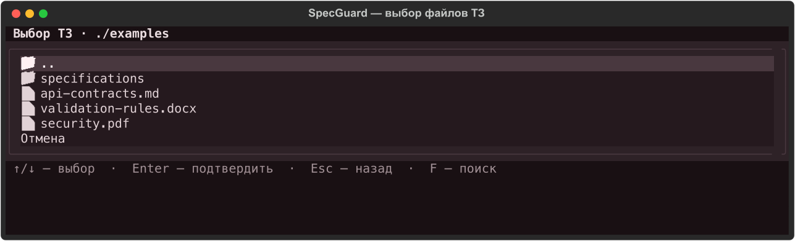
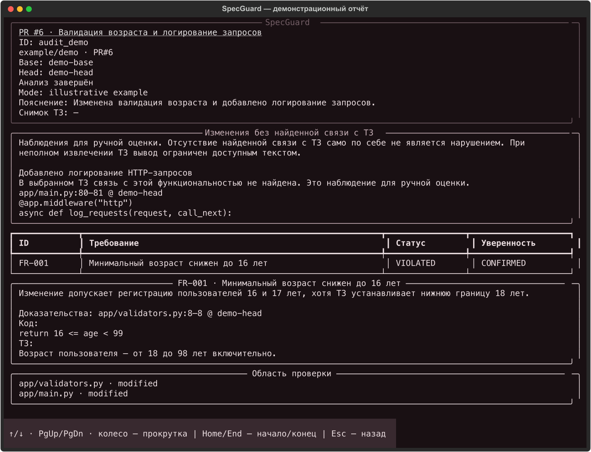
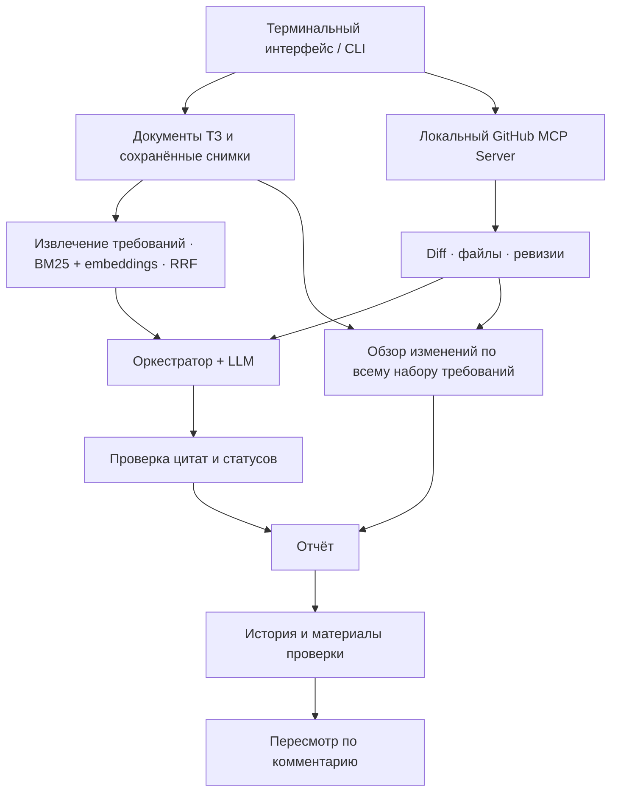

<div align="center">

# SpecGuard

### Проверка Pull Request и коммитов на соответствие техническому заданию

Локальный AI-агент с терминальным интерфейсом, RAG и GitHub MCP.

**Python 3.10+ · GitHub MCP · OpenAI-совместимые API · Русский / English**

[Быстрый старт](#быстрый-старт) · [Настройка](#настройка) · [Возможности](#возможности) · [Команды](#команды) · [Архитектура](#архитектура)

</div>



## Что такое SpecGuard

SpecGuard помогает проверить, соответствует ли изменение кода загруженному техническому заданию. Вы выбираете документы и PR или коммит, кратко описываете выполненную работу — агент получает изменения через GitHub MCP, находит связанные требования через RAG и формирует отчёт с цитатами кода и ТЗ.

Проверка отвечает на три вопроса:

- **Что реализовано?** Какие требования подтверждаются переданными изменениями.
- **Что противоречит ТЗ?** Какие нарушения обнаружены, чем они подтверждены и где остаётся неопределённость.
- **Что добавлено сверх описанного?** Для каких изменений не найдена связь с выбранными требованиями. Это отдельные наблюдения для ручной оценки: отсутствие связи само по себе не считается нарушением.

Отчёт сохраняется вместе с материалами проверки. Замечание можно оспорить комментарием и получить пересмотр на тех же исходных данных.

## Возможности

| Возможность | Как это работает |
| --- | --- |
| Интерактивный CLI | Меню со стрелками, терминальный проводник и прокручиваемый отчёт |
| Несколько документов ТЗ | TXT, Markdown, DOCX и PDF с извлекаемым текстом в одном наборе |
| Повторное использование ТЗ | Выбор набора из прошлой проверки с возможностью добавить файлы |
| Работа с GitHub | Выбор репозитория и открытого PR, ввод ссылки на репозиторий или SHA коммита |
| Сохранённые репозитории | Добавленные по ссылке репозитории доступны для быстрого выбора |
| Проверка требований | Статусы реализации, нарушения и недостаточность данных |
| Обзор дополнительных изменений | Отдельный раздел для кода без найденной связи с ТЗ |
| Проверяемые цитаты | Пути, ревизии, строки, фрагменты кода и требований; проверка происхождения цитат по переданным материалам |
| История и пересмотр | Отдельные записи аудитов и оспариваний без замены исходного отчёта |
| Независимые модели | Отдельные адреса, модели и ключи для LLM и embeddings |
| Проверка API | Тестовый запрос к LLM или получение embedding-вектора из меню |
| Частичные результаты | Явные ограничения при недоступном коде, неполном diff или ошибках извлечения текста |

## Быстрый старт

### Установка

Понадобятся Python **3.10 или новее** и Git. Для живой проверки дополнительно нужны GitHub MCP Server, GitHub-токен и подключения к двум моделям.

```bash
git clone https://github.com/yarikpd/SpecGuard.git
cd SpecGuard

python3 -m venv .venv
source .venv/bin/activate
python -m pip install -e .

specguard
```

Команды активации выше приведены для macOS и Linux. В PowerShell используйте `.venv\Scripts\Activate.ps1`.

Если используете **uv**, после клонирования достаточно:

```bash
uv sync
uv run specguard
```

### Демонстрация без API и токенов

В репозитории есть небольшое [демонстрационное ТЗ](examples/demo-spec.md):

```bash
specguard audit \
  --demo \
  --spec examples/demo-spec.md \
  --repo example/demo \
  --target 1 \
  --summary "Проверка валидации пароля" \
  --lang ru
```

В режиме `--demo` GitHub, LLM и embeddings заменяются имитациями. Он позволяет пройти основной сценарий и посмотреть историю; результат не описывает реальный репозиторий. Отдельный обзор изменений без связи с ТЗ выполняется в живом режиме.

## Настройка

### 1. GitHub MCP

SpecGuard запускает локальный GitHub MCP Server по `stdio`. Самостоятельно держать сервер запущенным в отдельном терминале не нужно. Для текущей интеграции закреплена версия **v2.0.3**.

1. Скачайте бинарный файл для своей ОС из [официального релиза](https://github.com/github/github-mcp-server/releases/tag/v2.0.3). Для Mac с Apple Silicon нужен архив `github-mcp-server_Darwin_arm64.tar.gz`.
2. Распакуйте его вне папки проекта. На macOS/Linux разрешите запуск файла, например:

   ```bash
   chmod +x ~/tools/github-mcp-server
   ```

3. Создайте [fine-grained GitHub-токен](https://github.com/settings/personal-access-tokens/new), выберите нужные репозитории и задайте права **Contents: Read-only**, **Pull requests: Read-only**. GitHub добавляет **Metadata: Read-only** автоматически.
4. В SpecGuard откройте **«Настройки GitHub MCP»**. Выберите исполняемый файл через проводник, введите токен и нажмите **«Проверить подключение»**.

Токен и путь к серверу сохраняются между запусками. Доступ к репозиториям зависит от прав токена и правил организации. Приложение использует MCP для чтения данных GitHub.

Подробности установки и проверки бинарного файла: [MCP_LIVE_SETUP.md](docs/MCP_LIVE_SETUP.md).

### 2. Модель для проверки и embedding-модель

Откройте **«Настройки моделей»** и выберите, какое подключение изменить:

- **Для проверки** — текстовая LLM, которая сопоставляет код с требованиями.
- **Для embedding** — модель, которая строит векторы требований для семантического поиска.

У каждой модели отдельно настраиваются **API URL**, **имя модели** и **API-ключ**. Имя можно выбрать из списка сервера или ввести вручную. Если локальный сервер не требует ключ, поле можно оставить пустым.

**URL должен быть полным адресом конечной точки. SpecGuard отправляет запрос по введённому адресу без автоматического добавления пути.**

| Подключение | Пример полного URL |
| --- | --- |
| Локальная LLM через Ollama | `http://localhost:11434/v1/chat/completions` |
| Локальные embeddings через Ollama | `http://localhost:11434/v1/embeddings` |
| LLM через OpenAI API | `https://api.openai.com/v1/chat/completions` |
| Embeddings через OpenAI API | `https://api.openai.com/v1/embeddings` |
| Gemini через совместимый API | `https://generativelanguage.googleapis.com/v1beta/openai/chat/completions` |

Для Gemini используйте **OpenAI-совместимый endpoint**, а не нативный `/interactions`. Выбранная модель должна быть доступна вашему ключу и поддерживать соответствующий тип запросов. [Документация Gemini](https://ai.google.dev/gemini-api/docs/openai/).

Пункт **«Проверить подключение»** отправляет настоящий тестовый запрос: для LLM проверяется JSON-ответ, для embeddings — получение корректного вектора с показом его размерности. Успешный тест подтверждает техническую работоспособность подключения; качество аудита оценивается отдельно.

### Переменные окружения

Для настройки без интерактивного меню можно использовать переменные окружения. Они имеют приоритет над сохранёнными значениями.

| Переменная | Назначение |
| --- | --- |
| `SPECGUARD_LLM_URL` | Полный URL LLM endpoint |
| `SPECGUARD_LLM_MODEL` | Имя модели для проверки |
| `SPECGUARD_LLM_API_KEY` | Ключ LLM API |
| `SPECGUARD_EMBEDDING_URL` | Полный URL embedding endpoint |
| `SPECGUARD_EMBEDDING_MODEL` | Имя embedding-модели |
| `SPECGUARD_EMBEDDING_API_KEY` | Ключ embedding API |
| `GITHUB_PERSONAL_ACCESS_TOKEN` | GitHub-токен; при отсутствии используется `GITHUB_TOKEN` |
| `SPECGUARD_MCP_SERVER` | Путь к GitHub MCP Server |
| `SPECGUARD_MCP_TIMEOUT` | Таймаут одного MCP-запроса в секундах; по умолчанию `60` |
| `SPECGUARD_CONFIG` | Путь к файлу настроек; по умолчанию `.specguard/config.json` |

## Как провести проверку

1. В главном меню выберите **«Новая проверка»**.
2. Выберите файлы ТЗ в проводнике либо возьмите набор из предыдущей проверки. После выбора можно подтвердить набор или добавить документы.
3. Выберите источник **GitHub MCP**.
4. Выберите репозиторий из списка или вставьте ссылку на публичный репозиторий. Репозитории из ссылок сохраняются и показываются с отметкой **★**.
5. Выберите открытый PR либо введите номер PR или SHA коммита вручную.
6. Кратко поясните, что выполнено, и выберите язык отчёта: русский или английский.
7. Дождитесь индексации, анализа требований и обзора дополнительных изменений. Отчёт откроется в отдельном окне и сохранится в истории.



### Управление

| Где | Клавиши | Действие |
| --- | --- | --- |
| Меню и проводник | `↑` / `↓`, `Enter` | Выбрать и подтвердить пункт |
| Меню | `Esc` | Вернуться назад |
| Проводник ТЗ и MCP-сервера | `F` | Поиск по именам в текущей папке |
| Поиск в проводнике | `Enter`, затем `Enter` | Перейти к результатам и выбрать файл |
| Поиск в проводнике | `Esc` | Сбросить поиск |
| Список репозиториев | `D` на пункте **★** | Удалить сохранённый репозиторий из быстрого выбора |
| Отчёт | `↑` / `↓`, `Page Up` / `Page Down`, колесо | Прокрутить отчёт |
| Отчёт | `Home` / `End` | Перейти к началу или концу |
| Отчёт | `Esc` или `Q` | Закрыть просмотр |

Удаление репозитория из быстрого выбора не удаляет историю проверок.

## Что находится в отчёте

В начале показаны репозиторий, проверяемый PR или коммит, известные ревизии, пояснение пользователя и сведения о документах. Для PR отображаются **номер и название со ссылкой**, которую можно открыть нажатием.

Далее идут:

- **Изменения без найденной связи с ТЗ** — наблюдения о дополнительной функциональности с цитатами кода. Например, новый middleware логирования, для которого в выбранном ТЗ не найдено требования.
- **Результаты проверки требований** — статусы, пояснения и степень уверенности.
- **Доказательства и контрдоказательства** — фрагменты кода и ТЗ с указанием источников, строк и ревизий.
- **Ограничения и недостающие данные** — что не удалось прочитать, извлечь или подтвердить.
- **Область проверки** — файлы, полученные для анализа.



*Скриншоты показывают текущие компоненты интерфейса на демонстрационных данных. Пример отчёта иллюстрирует формат и не является результатом проверки реального PR.*

### Статусы

| Статус | Значение |
| --- | --- |
| `IMPLEMENTED` | Переданные изменения подтверждают реализацию требования |
| `VIOLATED` | Обнаружено противоречие требованию |
| `NOT_AFFECTED` | Требование не затронуто переданными изменениями |
| `INSUFFICIENT_DATA` | Данных недостаточно для обоснованного вывода |

Для нарушения отдельно указывается уверенность: **`CONFIRMED`** или **`SUSPECTED`**. Подтверждение происхождения цитаты не заменяет оценку того, насколько она поддерживает вывод модели.

Если модель вернула некорректную структуру ответа, приложение делает одну повторную попытку. При повторной ошибке требование отмечается как `INSUFFICIENT_DATA`, а доступные результаты сохраняются в частичном отчёте.

## История и оспаривание

Откройте **«История и пересмотр»**, выберите аудит и просмотрите сохранённый отчёт. Для оспаривания выберите замечание и оставьте комментарий.

Пересмотр использует материалы исходной проверки, включая сохранённые требования и Git-контекст. Изменения текущего PR и исходных файлов ТЗ не подменяют эти данные. Чтобы проверить обновлённый код, запустите новый аудит.

Каждый аудит получает отдельный ID. Комментарии и результаты пересмотров сохраняются отдельно от исходного отчёта. Набор ТЗ можно повторно использовать при новой проверке, даже если исходные файлы уже удалены: приложение загружает сохранённые снимки и заново строит индекс выбранной embedding-моделью.

## Команды

Все основные действия доступны и без пошагового меню.

```bash
# Аудит PR
specguard audit \
  --spec requirements.md \
  --repo owner/repository \
  --target 42 \
  --summary "Добавлена валидация входных данных" \
  --lang ru

# Аудит коммита: вместо номера PR передайте SHA
specguard audit --spec requirements.md --repo owner/repository --target COMMIT_SHA

# История и просмотр отчёта
specguard history
specguard show AUDIT_ID

# Оспаривание замечания
specguard dispute AUDIT_ID --req FR-001 --comment "Проверка выполняется в другом изменённом модуле"

# Настройка моделей и справка
specguard config
specguard audit --help
```

Для разового переопределения подключения доступны `--llm-url`, `--llm-model`, `--llm-api-key`, `--embedding-url`, `--embedding-model`, `--embedding-api-key`. Ключи удобнее задавать через меню или окружение, чтобы они не оставались в истории команд терминала.

Несколько файлов ТЗ и выбор сохранённых наборов доступны через интерактивное меню. В командном режиме `--spec` принимает один файл. Для пересмотра демонстрационного аудита добавляйте `--demo` к `specguard dispute`.

## Архитектура



**RAG.** Документы разбираются на требования с исходным текстом, условиями, исключениями и связями. Поиск объединяет BM25 и семантическую близость через Reciprocal Rank Fusion; связанные требования расширяют контекст анализа. При совпадении ID между документами используются префиксы `DOC1`, `DOC2` и далее.

**GitHub MCP.** Адаптер получает PR, коммиты и необходимые материалы, обрабатывает страницы результатов, ограничения выдачи и сбои. Merge-коммит анализируется относительно первого родителя. При недоступной базе отчёт явно ограничивает выводы о том, что именно внесено изменением.

**LLM.** Для найденных требований формируются отдельные запросы. Дополнительный запрос сопоставляет изменения со всем выбранным набором требований и выделяет наблюдения без найденной связи с ТЗ. Совместимость API и качество модели оцениваются отдельно.

**Защита и проверка.** Код, ТЗ и комментарии передаются как недоверенные данные с отделением от инструкций. Цитаты проверяются по доступным материалам; необоснованные подтверждения понижаются до недостаточности данных.

```text
specguard/
├── agent/       # Оркестрация, промпты, LLM, проверка области изменений
├── cli/         # Меню, проводник, просмотр отчётов, настройки и история
├── mcp/         # GitHub MCP, stdio-транспорт и проверка интеграции
├── models/      # Pydantic-контракты отчётов, требований и доказательств
├── rag/         # Парсеры, embeddings, гибридный индекс и снимки
└── eval/        # Инструменты оценочного набора

tests/           # Модульные, интеграционные и сквозные сценарии
specification/   # Техническое задание и критерии приёмки проекта
docs/            # Инструкции, протоколы и скриншоты
examples/        # Демонстрационные входные данные
```

## Локальные данные

По умолчанию пути считаются относительно папки, из которой запущен SpecGuard. Для общей конфигурации между разными рабочими папками задайте абсолютный `SPECGUARD_CONFIG`.

| Путь | Содержимое |
| --- | --- |
| `.specguard/config.json` | Адреса и имена моделей, путь к MCP-серверу |
| `.specguard/secrets.json` | API-ключи моделей и GitHub-токен |
| `.specguard/repositories.json` | Репозитории, сохранённые по ссылке |
| `.specguard_history/*.json` | Отчёты аудитов и исходные материалы |
| `.specguard_history/snapshots/` | Снимки документов ТЗ |
| `.specguard_history/disputes/` | Запросы и результаты пересмотра |

Секреты записываются отдельным файлом с правами `0600` на системах с POSIX-правами. Файл содержит ключи в открытом виде; это локальное хранение, а не шифрованное хранилище. Папки настроек и истории исключены из Git.

Приложение работает локально, но выбранные внешние API получают данные, необходимые для запросов: embedding API — текст для векторизации, LLM API — требования и код для анализа. Для локальной обработки можно настроить локальные серверы моделей.

## Тестирование и разработка

Установка с зависимостями для разработки и запуск тестов:

```bash
python -m pip install -e '.[dev]'
python -m pytest tests/ -q
```

Либо через uv:

```bash
uv sync --extra dev
uv run pytest tests/ -q
```

Для отдельных областей:

```bash
python -m pytest tests/unit/ -q
python -m pytest tests/e2e/ -q
python -m pytest tests/test_parsers.py tests/test_snapshots_and_service.py -q
```

В тестах есть управляемые ответы GitHub и моделей, проверки отказов, защиты от недоверенных инструкций, истории, повторного использования ТЗ и клавиатурного управления интерфейсом. Каталог `tests/e2e/` содержит сквозные сценарии Python-конвейера; интерактивные компоненты также проверяются через Textual Pilot.

Живая интеграция проверяется отдельно: [инструкция](docs/MCP_LIVE_CHECK.md), [сохранённый протокол MCP](docs/protocols/mcp-live-20261030-094914.md). Доступность настоящего сервера, права токена и ответы внешних моделей зависят от окружения.

Текущий `specguard/eval/benchmark_runner.py` демонстрирует формат таблицы на эталонах с имитацией результатов. Его вывод не является измерением точности реальной модели.

При изменении логики добавляйте проверку воспроизводимого сценария. Ошибки удобно описывать с командой запуска, типом документа, используемой моделью и обезличенным фрагментом отчёта. Ключи и токены в issue не нужны.

## Границы проверки

- Агент читает материалы GitHub; он не запускает код и тесты проверяемого приложения и не публикует результаты в GitHub.
- PDF должен содержать извлекаемый текст. OCR сканов не выполняется. Повреждённые таблицы символов и пропуски извлечения отражаются в ограничениях.
- Неполный diff, недоступные файлы и ошибки модели могут дать частичный отчёт. Пропущенный материал не считается проверенным.
- Отсутствие найденных нарушений не доказывает полное соответствие проекта ТЗ. Основной анализ использует требования, найденные RAG; отдельный обзор области изменений получает весь выбранный набор требований.
- Дополнительный код может быть допустимым техническим решением. Наблюдения без найденной связи с ТЗ требуют ручной оценки.
- Результат зависит от модели, извлечения документов и доступного контекста. Окончательное решение принимает человек.

## Документация

- [Техническое задание](specification/TECHNICAL_SPEC.md)
- [Критерии приёмки](specification/ACCEPTANCE_CRITERIA.md)
- [Архитектура](specification/ARCHITECTURE.md)
- [Дизайн RAG](specification/RAG_DESIGN.md)
- [Интеграция MCP](specification/MCP_INTEGRATION.md)
- [Установка GitHub MCP](docs/MCP_LIVE_SETUP.md)
- [Живая проверка MCP](docs/MCP_LIVE_CHECK.md)
- [План оценки качества](specification/EVALUATION_PLAN.md)
