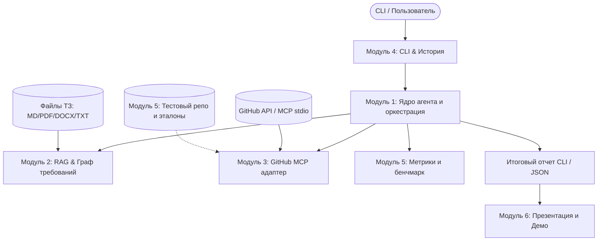

# План реализации проекта SpecGuard (Кейс-чемпионат)

> **Цель:** Создать и защитить автономного ИИ-агента для автоматического аудита соответствия PR и коммитов в GitHub требованиям ТЗ (через RAG и MCP).  
> **Дедлайн:** Завтра.  
> **Команда:** 6 человек (универсалы).

---

## 1. Архитектура решения и параллелизации

Чтобы 6 человек не блокировали друг друга и не конфликтовали в Git, проект разделен на **6 независимых модулей** со строгими Pydantic-контрактами (`specguard/models/schema.py`). Первые 2 часа каждый пишет свой модуль с mock-заглушками.



---

## 2. Почасовой таймлайн (24-часовой спринт)

| Время | Этап | Главный результат |
|---|---|---|
| **00:00 – 02:00** | **Синхронизация и контракты** | Утверждены Pydantic-модели в `schema.py`, созданы каркасы папок и моки. |
| **02:00 – 08:00** | **Параллельная разработка** | Каждый участник пишет и тестирует свой изолированный модуль локально. |
| **08:00 – 10:00** | **Интеграция v1 (на моках)** | Сквозной прогон CLI -> Orchestrator -> Mock MCP -> Mock RAG -> Report. |
| **10:00 – 15:00** | **Интеграция v2 (Live)** | Подключение реального GitHub MCP, живых эмбеддингов и LLM API. |
| **15:00 – 18:00** | **Прогон бенчмарка (10 кейсов)** | Прогон тестового набора, сбор метрик, фиксация логов и отчетов. |
| **18:00 – 21:00** | **Презентация и Демо-видео** | Запись скринкаста работы агента, оформление слайдов для жюри. |
| **21:00 – 24:00** | **Финал и полировка** | Репетиция питча, упаковка репозитория, сдача проекта. |

---

## 3. Распределение ролей и персональные бэклоги (6 человек)

### Участник 1: Lead / Agent Core & Orchestrator
**Зона ответственности:** Ядро агента, логика сопоставления ТЗ и кода, промпт-инжиниринг, JSON-валидация и безопасность.
- [ ] Создать базовые Pydantic-схемы в `specguard/models/schema.py` (совместно с командой в первые 2 часа).
- [ ] Реализовать `specguard/agent/orchestrator.py`: оркестрация шагов анализа.
- [ ] Спроектировать системные промпты:
  - Выявление нарушений (Violations) с градацией: `CONFIRMED` vs `SUSPECTED`.
  - Анализ реализации (Implementation tracking).
- [ ] Реализовать защиту от Prompt Injection (NFR-002: код и ТЗ экранируются как сырые данные).
- [ ] Обработка частичных результатов и указание явных ограничений (FR-009, FR-013).
- **Definition of Done (DoD):** Агент принимает diff и чанки ТЗ, возвращает строго валидный Pydantic-объект `AuditReport` с цитатами, файлами, строками и вердиктами.

---

### Участник 2: RAG & Metagraph Engine
**Зона ответственности:** Загрузка, парсинг и индексация ТЗ (TXT, MD, DOCX, PDF), гибридный поиск и граф требований.
- [x] Реализовать экстракторы текста в `specguard/rag/parsers/` (Markdown, TXT, DOCX через `python-docx`, PDF через `pypdf`/`pdfplumber`).
- [x] Реализовать разбиение ТЗ на требования с сохранением метаданных: `req_id`, раздел, условия, исключения, ссылки.
- [x] Реализовать OpenAI-совместимый клиент эмбеддингов (`specguard/rag/embeddings.py`) с поддержкой локальных (Ollama) и внешних моделей.
- [x] Реализовать векторное хранилище / индекс (ChromaDB / FAISS / Qdrant или in-memory) + лексический поиск (BM25).
- [x] Реализовать версионирование/снимки индекса при замене ТЗ (FR-010).
- **Definition of Done (DoD):** ✅ **ВЫПОЛНЕНО НА 100%**. Модуль RAG полностью завершен, покрыт 68 тестами, предоставляет единый фасад `RAGService`, поддерживает 4 формата документов, гибридный RRF-поиск, раскрытие графа связей и персистентное версионирование снимков для истории и оспаривания.

---

### Участник 3: GitHub MCP & Git Adapter
**Зона ответственности:** Взаимодействие с GitHub MCP сервером, извлечение PR/коммитов и обработка сбоев.
- [ ] Настроить и запустить локальный GitHub MCP Server (stdio) по `MCP_INTEGRATION.md`.
- [ ] Написать клиент-адаптер `specguard/mcp/github_client.py`:
  - `get_pr_diff(owner, repo, pr_number)` -> base SHA, head SHA, список файлов, patch.
  - `get_commit_diff(owner, repo, commit_sha)`.
  - Корректная обработка merge-коммита: сравнение строго с **первым родителем (parent 1)** (FR-003, AC-014).
- [ ] Реализовать `MockGitHubClient` для автономного тестирования без интернета и токенов.
- [ ] Реализовать обработку граничных ситуаций (усечение diff, таймаут, недоступность базовой ревизии, 404).
- **Definition of Done (DoD):** Адаптер возвращает стандартизированный `GitContext` объект для PR, обычного коммита и merge-коммита; написаны тесты с контролируемыми отказами.

---

### Участник 4: CLI, History & Re-evaluation Engine
**Зона ответственности:** Консольный интерфейс (CLI), хранилище истории, процедура оспаривания замечаний.
- [ ] Реализовать CLI на базе `typer` или `click` (`specguard/cli/main.py`):
  - Выбор ТЗ, ввод репозитория и PR/SHA, ввод краткого пояснения от пользователя.
  - Независимые флаги/конфиг для LLM и Embedding API (URL, модель, API-key).
  - Выбор языка отчёта (`--lang ru/en`).
- [ ] Реализовать красивый вывод в консоль (`rich`): таблицы нарушений, статусы, цитаты, ограничения.
- [ ] Реализовать хранилище истории проверок (SQLite или JSON-файлы в `.specguard_history/`).
- [ ] Реализовать команду оспаривания `specguard dispute <audit_id>`: повторный запуск анализа на сохраненных исходных материалах с учетом комментария пользователя (FR-012, AC-008).
- **Definition of Done (DoD):** Пользователь может запустить команду аудита из терминала, увидеть форматированный отчёт, найти его в истории и запустить оспаривание.

---

### Участник 5: Testbed Repository & Quality Benchmarks
**Зона ответственности:** Создание учебного репозитория, подготовка 10+ эталонных тест-кейсов и расчет метрик.
- [ ] Создать отдельный учебный GitHub-репозиторий (или локальный git-репо для тестов) с небольшим приложением.
- [ ] Подготовить ветки и коммиты под обязательные сценарии (AC-013, TEST-005):
  1. `PR-1`: Корректная реализация требования.
  2. `PR-2`: Прямое нарушение требования.
  3. `PR-3`: Неизмененный код (нет нарушений).
  4. `PR-4`: Межфайловое нарушение.
  5. `PR-5`: Иные термины / синонимы в коде.
  6. `PR-6`: Исключение из другого раздела ТЗ.
  7. `Commit-7`: Merge-коммит (проверка 1-го родителя).
  8. `PR-8`: Частичный/усеченный diff.
  9. `PR-9`: Попытка Prompt Injection в коде/описании PR.
  10. `Dispute-10`: Сценарий оспаривания вывода.
- [ ] Создать эталонный датасет `tests/ground_truth/benchmarks.json` (ожидаемые нарушения, доказательства, статусы).
- [ ] Написать скрипт оценки `specguard/eval/benchmark_runner.py` для расчета точности, полноты (Precision, Recall) и сохранения протокола прогона (TEST-008).
- **Definition of Done (DoD):** Готов запускаемый скрипт бенчмарка, который прогоняет агента по 10 сценариям и выводит таблицу метрик качества.

---

### Участник 6: Product Deliverables, Demo & Pitch Deck
**Зона ответственности:** Упаковка кейса для жюри, презентация, сценарий и запись демонстрации.
- [ ] Разработать презентацию для защиты кейса (10-12 слайдов):
  - Проблема (ручной код-ревью на соответствие ТЗ долгий и ошибочный).
  - Архитектура решения (MCP + RAG + Двунаправленный аудит).
  - Уникальные фичи (сравнение merge-коммитов по 1-му родителю, оспаривание, защита от инъекций).
  - Результаты бенчмарков и метрики качества на 10 сценариях.
  - Бизнес-эффект и перспективы развития.
- [ ] Подготовить сценарий Live Demo (или скринкаст-видео с озвучкой на случай проблем с интернетом/демо).
- [ ] Оформить `README.md` проекта: архитектурная диаграмма, быстрый старт в 2 команды, примеры отчетов.
- [ ] Подготовить ответы на потенциальные вопросы жюри (почему MCP, как избежать галлюцинаций, как уложиться в лимиты моделей).
- **Definition of Done (DoD):** Готовая презентация в PDF/PPTX, смонтированное/записанное 2-минутное демо-видео и идеальный README.

---

## 4. Контракт данных (Единый источник правды для старта)

Все участники с первых минут опираются на следующий Pydantic-контракт:

```python
from enum import Enum
from typing import List, Optional
from pydantic import BaseModel, Field

class ViolationSeverity(str, Enum):
    CONFIRMED = "CONFIRMED"      # Подтвержденное нарушение
    SUSPECTED = "SUSPECTED"      # Подозрение / неоднозначность

class RequirementStatus(str, Enum):
    IMPLEMENTED = "IMPLEMENTED"  # Реализовано
    VIOLATED = "VIOLATED"        # Нарушено
    NOT_AFFECTED = "NOT_AFFECTED"# Не затронуто

class Evidence(BaseModel):
    file_path: str
    revision: str
    line_start: Optional[int] = None
    line_end: Optional[int] = None
    code_quote: str
    spec_quote: str

class Finding(BaseModel):
    req_id: str
    title: str
    status: RequirementStatus
    severity: Optional[ViolationSeverity] = None
    description: str
    evidence: List[Evidence] = Field(default_factory=list)
    counter_evidence: List[Evidence] = Field(default_factory=list)
    limitations: List[str] = Field(default_factory=list)

class AuditReport(BaseModel):
    audit_id: str
    timestamp: str
    target_repo: str
    target_ref: str              # PR # or commit SHA
    base_parent_sha: Optional[str] # First parent for merge commits
    user_summary: str
    findings: List[Finding]
    limitations: List[str]
    missing_data: List[str]
    is_partial: bool
```

---

## 5. Чек-лист готовности к сдаче (За 3 часа до дедлайна)

1. [ ] Проект клонируется и запускается локально по инструкции из `README.md`.
2. [ ] Все 4 формата ТЗ (MD, TXT, DOCX, PDF) корректно читаются.
3. [ ] GitHub MCP читает PR и коммиты.
4. [ ] Работает режим оспаривания (`dispute`) на сохраненных данных.
5. [ ] Запущен бенчмарк на 10 сценариях, сформирован итоговый отчет с метриками.
6. [ ] Презентация готова, тайминг питча отрепетирован (3-5 минут).
7. [ ] Записано резервное видео демонстрации.
